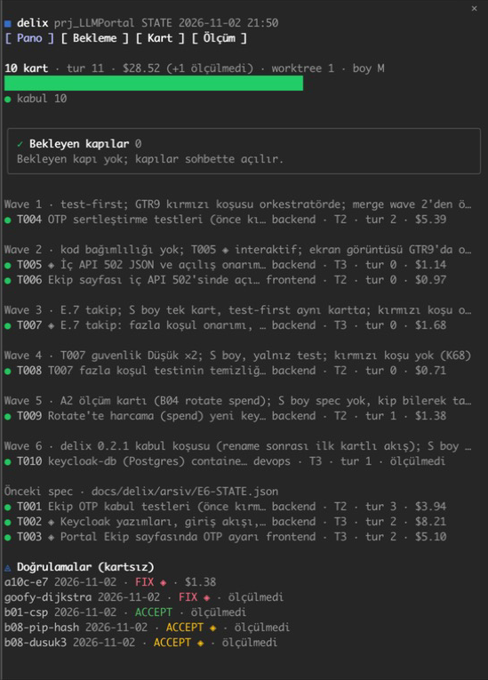

# delix — a team workflow for Claude Code

**Spec first. Agents build. You hold the gates.**

`delix` turns the single-session loop of "open, pick a folder, read the history, continue" into the division of labour
of a real software team: an **orchestrator** session writes a tech spec through a grill interview, splits the work into
task cards, hands each card to an **implementer** session running in its own worktree, and has **read-only reviewers**
(qa, security) check the result. A human is involved at exactly two gates: **spec approval** and **PR merge**. The
constraints live in the harness, not in the prompt: reviewer roles have no write tool in their `tools` list, plugin hooks
block writes to protected paths and changes to test files, and the Stop hook does not close an implementer turn until the
tests pass.

Türkçe sürüm: [README.tr.md](README.tr.md). Design and evidence (Turkish): [tech spec](docs/spec/ekip-tech-spec.md) ·
[research report](docs/research/reports/Çoklu%20ajan%20yazılım%20ekibi%20orkestrasyonu.md) · decisions [STATUS.md](STATUS.md).
The skills reply in the user's language; labels, status values and verdict tokens stay in English.

## Requirements

- **Claude Code** with plugin marketplaces; tested with 2.1.309, older versions not tested.
- **`python3`** on `PATH` (tested with 3.9). The hooks are Python scripts and block on failure, so without it every
  Write, Edit and Bash call is blocked, in every session, with the line `delixcrew: python3 not found on PATH …`.
- **`git`**: implementer sessions work in worktrees on card branches.
- Optional: **`gh`** (GitHub CLI, signed in) to open and read PRs; without a remote the commits stay on the card branch
  and the report says `**PR:** none`. **`gitleaks`**: a secret scan before every implementer commit; without it a note
  goes to `.delix/warnings.log`.

No GitHub SSH key is needed: `marketplace add` tries SSH and falls back to HTTPS.

## Installation

From GitHub (Desktop and terminal, no `--plugin-dir` needed):

```bash
claude plugin marketplace add tahircengiz/delixcrew
```

```bash
claude plugin install delixcrew@delixcrew
```

From a local clone: `claude plugin marketplace add /path/to/delix`, then the same `install` command. The marketplace
definition is [`.claude-plugin/marketplace.json`](.claude-plugin/marketplace.json). Both installs copy the plugin into
Claude's plugin cache, one folder per version, so an install updates only when the version in `plugin.json` changes:
run `claude plugin marketplace update delixcrew` (GitHub; a local folder is read directly), then
`claude plugin update delixcrew@delixcrew`, and restart Claude. A local change without a version bump does not reach the
installed copy, `git pull` alone is not enough; to try one, `claude --plugin-dir /path/to/delix` reads the folder in place.
Installed before 0.4.0 as plugin `delix` (or under the marketplace name `delix-local`): see the [CHANGELOG](CHANGELOG.md#040--2026-11-03).
Checks (also run by CI on every push and PR): `claude plugin validate .`; hook tests: `bash tests/hook_tests.sh`; board tests:
`bash tests/board_tests.sh`; behaviour evals: `claude plugin eval . --trust-plugin --no-publish` (calls the model, costs money).

### Companion: delix-board

[`delix-board`](plugins/delix-board/README.md) is a separate, read-only mod in the same marketplace: a live pane with the
board, long runs, card details and metrics, a band above the prompt and a toast when a run ends. It is not needed for
delix to work and draws nothing in headless sessions.

```bash
claude plugin install delix-board@delixcrew
```



## Flow

| Step | Command | What happens |
|---|---|---|
| 1 | `/delixcrew:start <request>` | Context is read; **size** (S/M/L: process weight) and **tier** (1/2/3: gates) are proposed; `docs/delix/` is set up. For S, a single card. |
| 2 | `/delixcrew:spec` | Grill (one question at a time, with a pick) → `docs/delix/SPEC.md` (SHALL + WHEN/THEN); `architect` (+ `security` at Tier 3) reviews; EGM at size L. For UI work only, a design-system step: the spec links `DESIGN.md` (or the repo's token file), and produces `DESIGN.md` when neither exists. **Gate 1.** |
| 3 | `/delixcrew:dispatch` | `architect` writes the cards and the wave plan; conflict check; dispatch prompts; implementer sessions (at most 3 in parallel). |
| 4 | `/delixcrew:implement <card>` | In the implementer session: test-first, only the card's files, a PR, `.delix/report.md`. |
| 5 | `/delixcrew:review <card>` | Deterministic gates → `qa` (+ `security`) with zero context → ≤ 3 fix rounds → **Gate 2 (merge, human).** |
| 6 | `/delixcrew:close` | STATUS/CHANGELOG, metrics (cost, rounds), drift check, approved memory writes, worktree cleanup. |
| shortcut | `/delixcrew:verify <branch\|commit\|dir>` | **Only verifies** work done without a card (a single session or you) (K43): gitleaks, local tests, a remote **isolated** unit test (separate directory + separate image, never touches the live stack), `--full` on request; `qa` (+ `security`) in a **single pass**, no fix rounds → a `docs/delix/verifications/<date>-<name>.md` report (ACCEPT / FIX, 🔐) and `STATE.json.verifications`. For S/M + well-described + Tier ≤ 2 work, `/delixcrew:start` proposes this; the full flow is for Tier 3 / parallel cards / an unclear spec. |
| any time | `/delixcrew:status` | Read-only board: wave · card · role · tier · status · rounds · PR · cost · last report · pending gate (🔐, merge) table in the chat; on request (`--write`) to `docs/delix/BOARD.md` (not committed). |

## Roles

| Role | Unit | Permissions | Model |
|---|---|---|---|
| orchestrator | main session | writes no code | top |
| `delixcrew:architect` | subagent | Read, Grep, Glob | opus |
| implementer (backend / frontend / ui-ux / devops / docs role note) | separate session, worktree | everything; a protected path or an existing test file only when listed in the card's Files (a protected path additionally needs a 🔐 Approved line); the card and `docs/delix/**` blocked by hook | sonnet |
| `delixcrew:qa` | subagent | Read, Grep, Glob | sonnet |
| `delixcrew:security` | subagent | Read, Grep, Glob + read-only scanner Bash | opus |
| `delixcrew:scout` | subagent | Read, Grep, Glob | haiku |

## Files on the project side

`docs/delix/delix.json` (test command, protected paths, test paths, max parallel, the `verify` remote isolated-run block),
`docs/delix/SPEC.md`, `docs/delix/tasks/T<nnn>-<slug>.md`, `docs/delix/STATE.json` (cards + `verifications` records),
`docs/delix/verifications/<date>-<name>.md|.patch` (`/delixcrew:verify` report and patch), `docs/delix/BOARD.md` (generated only
on request, in `.gitignore`). In the implementer worktree: `.delix/card` (activates the hooks), `.delix/report.md`,
`.delix/test-result.txt`, `.delix/evidence/`.

## Feedback

When delixcrew itself misbehaves (a hook rejects correct work, a skill step cannot be followed as written, you work
around a plugin limit by hand), it can keep a local draft of the problem so you can send it to this repo as a GitHub
issue. Nothing leaves your machine unless you send it yourself, from your own terminal.

**Off by default.** Turn it on (and off) in your own terminal; the script lives in the plugin's install directory, for
a marketplace install `~/.claude/plugins/cache/delixcrew/delixcrew/<version>/scripts/feedback.py`:

```bash
python3 <plugin dir>/scripts/feedback.py enable --terms acme,example-corp
```

`--terms` adds your own words to redact (customer names, codenames). `status` shows whether it is on, the queue
directory and the number of drafts; `disable` turns it off. While it is off nothing is written: `/delixcrew:feedback note` shows
`delixcrew feedback is off; enable: python3 <path>/feedback.py enable` with the real path, and `/delixcrew:close` and
`/delixcrew:review` stay silent. Drafts live in
`~/.claude/delixcrew/feedback/` (`DELIXCREW_FEEDBACK_DIR` overrides it), never in your project repo.

**Flow.**
1. A draft is created by `/delixcrew:feedback note` (a finding from the current conversation), or by `/delixcrew:close`
   and `/delixcrew:review` when one of the three events above happened. A repeated finding raises the draft's count
   instead of adding a new one.
2. `/delixcrew:feedback review` shows each draft **exactly** as it would be published (repo, label, title, body), with a
   `VERDICT:` and a `HASH:` line.
3. To send a draft, reply in chat with its id: `yes F003` (or `evet F003`). A bare "yes", "send all" or "approved" in a
   file is not consent. Claude then gives you one command:
   `python3 <plugin dir>/scripts/feedback.py send F003 --confirm <hash>`.
4. Run it in **your own terminal**. It prints the queue directory and the full text again and waits for you to type
   `SEND <hash>`. If the text changed since the preview, it stops and asks you to preview again.

Claude never sends: in every session the hooks deny `feedback.py send`, running `feedback.py` under `script`, `expect`,
`unbuffer` or `pty.spawn`, `gh issue create|comment|edit` and `gh api … issues` aimed at delixcrew, and Write/Edit into
the queue directory, with `delixcrew: feedback is sent only by the user from their own terminal`.

**Requirements for sending:** `gitleaks` on `PATH` and a signed-in `gh`. Without `gitleaks` every draft is `BLOCKED`;
without `gh` the draft stays queued and `send` exits 7. The target repo is fixed to `tahircengiz/delixcrew`; before
creating an issue, `send` searches for the draft's fingerprint line (`delixcrew-fp: …`) and, if an issue already has it,
records that URL instead of opening a second one. You can also open an issue on GitHub by hand; the issue forms ask the
same headings.

**What is redacted** (before the preview, title included): every host name outside a short allowlist (`github.com`,
`code.claude.com`, `docs.anthropic.com`, `anthropic.com`, `example.*`, `*.example`, `*.test`, `*.invalid`, `localhost`),
so `build.example-corp.dev` becomes `<redacted:host>`; IP addresses outside the documentation ranges and loopback
(`10.1.2.3` → `<redacted:ip>`); MAC and e-mail addresses; the user part of home paths (`/Users/<you>/x` → `~/x`) and
every other absolute path (`/srv/app` → `<redacted:path>`); your user name and machine name; the names of the projects the drafts came
from (folder name, git remote owner and repo) and your `--terms`.

**What blocks a draft** (`VERDICT: BLOCKED: <reason>`, `send` exits 4; no secret value is printed): a `gitleaks` finding in
the raw or the redacted text, or `gitleaks` missing, failing or timing out; an invisible Unicode control character
(zero-width, bidi); an opaque string of 32+ characters (`[A-Za-z0-9+=_-]`, so a full git SHA is blocked too; use the
short one); more than 15 code lines; a body over 8 KB; anything still matching the redaction rules after redaction.

**Remaining risk.** The hooks close the *known* ways to send; they do not block everything. Claude runs with your `gh`
login, and a disguised command (one built from base64, a wrapper written to a file, an HTTP request without `gh`) can get
past a pattern-matching hook. This is true of any Claude session, with or without delixcrew. If you want a stronger
guard, add a deny rule to your own `settings.json`; delixcrew only suggests this and does not change your settings:

```json
{ "permissions": { "deny": ["Bash(gh issue create:*)", "Bash(gh api:*)"] } }
```

## Known limits

Plugin agents ignore the `permissionMode`, `hooks` and `mcpServers` fields (the constraint is `tools` + `hooks/hooks.json`).
Hooks load in every session where the plugin is installed; the implementer gates run only when `cwd/.delix/card` exists,
the reviewer gates only when `agent_type` is `delixcrew:*`. Experimental Agent Teams are not used. There is no plugin monitor:
the former watcher never started in the pilot and 3 diagnostic runs and was removed on 2026-11-01 (retro A9, K35).
`/delixcrew:status` also works under `-p`. When `gitleaks` is installed, a secret scan runs before every commit; otherwise a
note is appended to `.delix/warnings.log`.

The write gate (`scripts/write_gate.py`) sees only the Write/Edit/MultiEdit/NotebookEdit tools; an implementer writing
files through Bash (`echo >`, `sed -i`, `tee`) is outside this hook (`bash_gate.py` intercepts only redirects, `cp`, `mv`
and `tee` into protected paths, reviewer Bash and, in every session, the known feedback send paths; see
[Feedback](#feedback)). A path escaping the worktree (cwd) is always rejected (A13, K42); path matching is relative to cwd. For
that reason a change to the card file, `docs/delix/**` or an unapproved protected path in the card counts as a finding in
the `delixcrew:qa` review of the diff. Tier 3 permission is opened by the `**🔐 Approved:** <YYYY-MM-DD> <who>` line after
the card's header table; only the orchestrator writes it, after the user's explicit "yes" in chat, and commits it to main.

## License

MIT, see [LICENSE](LICENSE). Source and issues: <https://github.com/tahircengiz/delixcrew>.
