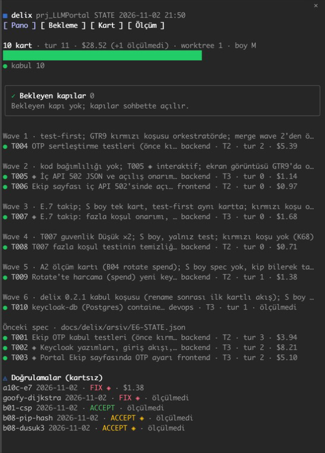

# delix — Claude Code için ekip düzeni

**Spec first. Agents build. You hold the gates.**

`delix`, tek oturumda "aç, klasör seç, geçmişi oku, devam et" döngüsünü gerçek bir yazılım ekibinin iş bölümüne
çevirir: **ekip lideri** oturumu grill ile tech spec yazar, işi görev kartlarına böler, her kartı kendi worktree'sinde
çalışan bir **uygulayıcı** oturumuna verir, **salt-okunur inceleyicilerle** (qa, security) denetler. İnsan yalnız iki
kapıda devrededir: **spec onayı** ve **PR merge**. Kısıtlar prompt'ta değil harness'tadır: inceleyici rollerin `tools`
listesinde yazma aracı yoktur, plugin hook'ları korunan yollara yazmayı ve test dosyası değiştirmeyi engeller, Stop
hook'u testler geçmeden uygulayıcı turunu kapatmaz.

English version: [README.md](README.md). Tasarım ve kanıt: [tech spec](docs/spec/ekip-tech-spec.md) ·
[araştırma raporu](docs/research/reports/Çoklu%20ajan%20yazılım%20ekibi%20orkestrasyonu.md) · kararlar [STATUS.md](STATUS.md).
Skill'ler kullanıcının dilinde cevap verir; etiketler, durum değerleri ve karar kelimeleri İngilizce kalır.

## Gereksinimler

- **Claude Code** (plugin marketplace desteğiyle); 2.1.309 ile denendi, eski sürümler denenmedi.
- `PATH`'te **`python3`** (3.9 ile denendi). Hook'lar Python betiğidir ve hata olunca engeller; python3 yoksa her
  oturumda her Write, Edit ve Bash çağrısı `delixcrew: python3 not found on PATH …` satırıyla engellenir.
- **`git`**: uygulayıcı oturumlar kart dallarında, worktree'lerde çalışır.
- İsteğe bağlı: **`gh`** (GitHub CLI, oturum açık) PR açmak ve okumak için; remote yoksa commit'ler kart dalında kalır ve
  rapor `**PR:** none` yazar. **`gitleaks`**: uygulayıcının her commit'inden önce sır taraması; yoksa
  `.delix/warnings.log`'a not düşülür.

GitHub SSH anahtarı gerekmez: `marketplace add` önce SSH'ı dener, olmazsa HTTPS'e geçer.

## Kurulum

GitHub'dan (Desktop ve terminal, `--plugin-dir` gerekmez):

```bash
claude plugin marketplace add tahircengiz/delixcrew
```

```bash
claude plugin install delixcrew@delixcrew
```

Yerel klondan: `claude plugin marketplace add /path/to/delix`, sonra aynı `install` komutu. Marketplace tanımı
[`.claude-plugin/marketplace.json`](.claude-plugin/marketplace.json). İki kurulum da plugin'i Claude'un plugin
cache'ine sürüm başına bir klasör olarak kopyalar; kurulum yalnız `plugin.json` sürümü değişince güncellenir:
`claude plugin marketplace update delixcrew` (GitHub; yerel klasör doğrudan okunur), sonra
`claude plugin update delixcrew@delixcrew`, ardından Claude'u yeniden başlat. Sürüm artmadan yapılan yerel değişiklik
kurulu kopyaya ulaşmaz, `git pull` tek başına yetmez; denemek için `claude --plugin-dir /path/to/delix` klasörü yerinde okur.
0.4.0'dan önce `delix` plugin adıyla (ya da `delix-local` marketplace adıyla) kurduysan: [CHANGELOG](CHANGELOG.md#040--2026-11-03).
Doğrulama (CI her push ve PR'da da koşar): `claude plugin validate .`; hook testleri: `bash tests/hook_tests.sh`; pano testleri:
`bash tests/board_tests.sh`; davranış testleri: `claude plugin eval . --trust-plugin --no-publish` (model çağrısı yapar,
maliyeti vardır).

### Eşlikçi: delix-board

[`delix-board`](plugins/delix-board/README.md) aynı marketplace'te ayrı, salt-okunur bir mod: sohbetin yanında canlı
pane (pano, uzun koşular, kart ayrıntısı, ölçüm grafikleri), istem üstünde band ve koşu bitince toast. delix'in çalışması
için gerekmez; headless oturumlarda hiçbir şey çizmez.

```bash
claude plugin install delix-board@delixcrew
```



## Akış

| Adım | Komut | Ne olur |
|---|---|---|
| 1 | `/delixcrew:start <istek>` | Bağlam okunur; **size** (S/M/L: süreç ağırlığı) ve **tier** (1/2/3: kapılar) önerilir; `docs/delix/` kurulur. S ise tek kart. |
| 2 | `/delixcrew:spec` | Grill (tek soru, önerili) → `docs/delix/SPEC.md` (SHALL + WHEN/THEN); `architect` (+ Tier 3'te `security`) inceler; L'de EGM. Yalnız UI işinde bir design system adımı: spec `DESIGN.md`'ye (ya da repodaki token dosyasına) bağlanır, ikisi de yoksa `DESIGN.md` üretilir. **Kapı 1.** |
| 3 | `/delixcrew:dispatch` | `architect` kartları ve wave planını yazar; çakışma kontrolü; dispatch prompt'ları; uygulayıcı oturumları (en çok 3 paralel). |
| 4 | `/delixcrew:implement <kart>` | Uygulayıcı oturumda: test-first, yalnız kartın dosyaları, PR, `.delix/report.md`. |
| 5 | `/delixcrew:review <kart>` | Deterministik kapılar → `qa` (+ `security`) sıfır bağlamla → ≤ 3 düzeltme turu → **Kapı 2 (merge, insan).** |
| 6 | `/delixcrew:close` | STATUS/CHANGELOG, ölçüm (maliyet, tur), drift kontrolü, onaylı bellek yazımı, worktree temizliği. |
| kısa yol | `/delixcrew:verify <dal\|commit\|dizin>` | Kartsız yapılmış işi (tek oturum ya da sen) **yalnız doğrular** (K43): gitleaks, yerel test, uzak **izole** birim testi (ayrı dizin + ayrı imaj, canlı stack'e dokunmaz), istenirse `--full`; `qa` (+ `security`) **tek geçiş**, düzeltme turu yok → `docs/delix/verifications/<tarih>-<ad>.md` raporu (ACCEPT / FIX, 🔐) ve `STATE.json.verifications`. S/M + iyi tarif + Tier ≤ 2 işte `/delixcrew:start` bunu önerir; tam akış Tier 3 / paralel kart / belirsiz spec'e. |
| her an | `/delixcrew:status` | Salt-okunur pano: wave · kart · rol · tier · status · tur · PR · maliyet · son rapor · bekleyen kapı (🔐, merge) tablosu sohbete; istenirse (`--write`) `docs/delix/BOARD.md`'ye (git'e girmez). |
| issue'lar | `/delixcrew:triage [#n]` | delixcrew reposunda: gelen issue'ları temizlenmiş okur, salt-okunur `architect` her birini kontrol edip bir karar önerir; sohbette `<karar> #<n>` yazınca kaydeder ve yayınlanacak yorumu aynen gösterir; yayını siz kendi terminalinizden yaparsınız. Bkz. [Triage](#triage). |

## Roller

| Rol | Birim | Yetki | Model |
|---|---|---|---|
| ekip lideri | ana oturum | kod yazmaz | üst |
| `delixcrew:architect` | subagent | Read, Grep, Glob | opus |
| uygulayıcı (backend / frontend / ui-ux / devops / docs rol notu) | ayrı oturum, worktree | tümü; korunan yol ve var olan test dosyası yalnız kartın Files listesinde (korunan yol ek olarak 🔐 Approved satırıyla) açık, kart ve `docs/delix/**` hook'la engelli | sonnet |
| `delixcrew:qa` | subagent | Read, Grep, Glob | sonnet |
| `delixcrew:security` | subagent | Read, Grep, Glob + salt-okunur tarayıcı Bash | opus |
| `delixcrew:scout` | subagent | Read, Grep, Glob | haiku |

## Proje tarafı dosyalar

`docs/delix/delix.json` (test komutu, korunan yollar, test yolları, paralel üst sınır, `verify` uzak izole koşu bloğu),
`docs/delix/SPEC.md`, `docs/delix/tasks/T<nnn>-<slug>.md`, `docs/delix/STATE.json` (kartlar + `verifications` kayıtları),
`docs/delix/verifications/<tarih>-<ad>.md|.patch` (`/delixcrew:verify` raporu ve yaması), `docs/delix/BOARD.md` (yalnız istenince
üretilir, `.gitignore`'da). Uygulayıcı worktree'sinde `.delix/card` (hook'ları aktifleştirir), `.delix/report.md`,
`.delix/test-result.txt`, `.delix/evidence/`.

## Bu plugin makinende ne yapar

Yerelde ne çalışır, neyi yazar, ağa ne zaman çıkar. Geri bildirim taslağının içeriği ve nereye gittiği
[Veri ve gizlilik](#veri-ve-gizlilik) bölümünde; hook'ların nerede durduğu [Bilinen sınırlar](#bilinen-sınırlar)
bölümünde. Güvenlik bildirimi: [SECURITY.md](SECURITY.md).

**Hook'lar** ([`hooks/hooks.json`](hooks/hooks.json)) plugin'in etkin olduğu her oturumda yüklenir:
- `Write|Edit|MultiEdit|NotebookEdit` için `PreToolUse`, [`scripts/write_gate.py`](scripts/write_gate.py)'yi çalıştırır.
  Her oturumda aşağıdaki geri bildirim ve triage dizinlerine yazmayı reddeder; inceleyici agent'lar için her yazmayı
  reddeder. Uygulayıcı worktree'sinde ayrıca worktree dışına, karta ve `docs/delix/**`'a, onaylı kartı olmayan korumalı
  yola ve mevcut test dosyasına yazmayı reddeder.
- `Bash` için `PreToolUse`, [`scripts/bash_gate.py`](scripts/bash_gate.py)'yi çalıştırır. Her oturumda bilinen gönderme
  ve uygulama yollarını reddeder (`feedback.py send`, `triage.py apply`, `script` gibi terminal sarmalayıcıları ve bu
  repoyu hedefleyen yazan `gh issue`, `gh label` ya da `gh api` çağrıları). security inceleyicisi yalnız izinli bir
  tarayıcı ya da okuma komutuyla başlayan ve bilinen hiçbir yazma kalıbına uymayan komutları çalıştırabilir; bu bir kalıp
  denetimidir, sandbox değildir. Diğer inceleyicilere Bash verilmez. Uygulayıcı worktree'sinde korumalı yola kabuk
  yazmasını reddeder ve her `git commit`'ten önce `gitleaks protect --staged` çalıştırır.
- `Stop`, [`scripts/stop_gate.py`](scripts/stop_gate.py)'yi yalnız uygulayıcı worktree'sinde çalıştırır: projenin
  `docs/delix/delix.json` dosyasındaki `test_command` ve `extra_checks` komutlarını kabukta çalıştırır; bunlar geçene
  dek tur bitmez. Bu komutlar plugin'in değil, projenizin komutlarıdır.
- Uygulayıcı worktree'si, work tree kökünde yerel ve git'in izlemediği bir `.delix/card` bulunan worktree'dir
  ([`scripts/common.py`](scripts/common.py)). `python3` yoksa iki `PreToolUse` hook'u da engeller (bkz.
  [Gereksinimler](#gereksinimler)).

**Yazdığı dosyalar**
- Projenizde: `docs/delix/` (spec, kartlar, `cost_usd` alanlarıyla `STATE.json`, doğrulama raporları); ekip lideri
  skill'leri yazar ve `.gitignore`'da değildir, yani commit ettiğinizde reponuz kadar açık olur; `docs/delix/BOARD.md`
  yalnız `board.py --write` ile (`.gitignore`'da). Uygulayıcı worktree'sinde: `.delix/report.md`,
  `.delix/test-result.txt`, `.delix/evidence/` ve `gitleaks` yoksa `.delix/warnings.log`.
- Ev dizininizde: geri bildirim kuyruğu `~/.claude/delixcrew/feedback/` (dizin `0700`, dosyalar `0600`) ve triage
  kayıtları `~/.claude/delixcrew/triage/<n>.json`.
- Geçici: `/delixcrew:verify` çalışma alanı `${TMPDIR:-/tmp}/delix-verify-<ad>/` ve `feedback.py send` ile
  `triage.py apply`'ın `gh`'ye verdiği issue ya da yorum gövdesi; çağrıdan sonra silinir.

**Ağa ne zaman çıkar.** Hook betikleri kendileri bağlantı açmaz; `git` ve `gitleaks`'i yerelde çalıştırır. Stop kapısı
projenizin kendi komutlarını çalıştırır (yukarıda); onların ağ kullanımı kendilerinindir. Bunların dışında ağı şu
komutlar kullanır, her biri sizin hesaplarınızla:
- Bir skill söylediğinde Claude çalıştırır: `triage.py index|show|record|preview` bu reponun issue'larını
  `gh issue list|view` ile okur (`/delixcrew:triage`, `/delixcrew:start #<n>`); projenizin remote'unda `gh repo view`,
  `gh pr create` (uygulayıcı) ve `gh pr checks` (inceleme); `delix.json`'daki `verify.remote` host'una `ssh` ve `rsync`,
  yalnız o blok varsa (`/delixcrew:verify`, `/delixcrew:review`); `claude -p` ile başsız uygulayıcı oturumları
  (`/delixcrew:dispatch` ve `/delixcrew:review`'daki düzeltme turu). Claude `gh pr merge` çalıştırmaz.
- Yalnız siz, kendi terminalinizde çalıştırırsınız (TTY ve elle yazılmış `SEND <hash>` ya da `APPLY <hash>` ister):
  `feedback.py send` (`gh issue list`, `gh issue create`) ve `triage.py apply` (`gh label`,
  `gh issue comment|edit|close`). İkisi de `github.com/tahircengiz/delixcrew`'a sabittir ve ortamdan `GH_HOST` ile
  `GH_REPO`'yu çıkarır.

## Geri bildirim

delixcrew'un kendisi sorun çıkardığında (bir hook doğru işi reddeder, bir skill adımı yazıldığı gibi uygulanamaz, bir
plugin sınırını elle aşarsınız) sorunun yerel bir taslağını tutabilir; bunu bu repoya GitHub issue olarak
gönderebilirsiniz. delixcrew kendi başına göndermez: taslak siz kendi terminalinizde `send` çalıştırınca gider;
hook'lar Claude'un göndermesinin bilinen yollarını kapatır (bkz. Kalan risk).

**Varsayılan kapalı.** Kendi terminalinizde açıp kapatırsınız; betik plugin'in kurulum dizinindedir, marketplace
kurulumunda `~/.claude/plugins/cache/delixcrew/delixcrew/<version>/scripts/feedback.py`:

```bash
python3 <plugin dizini>/scripts/feedback.py enable --terms acme,example-corp
```

`--terms` redakte edilecek kendi kelimelerinizi ekler (müşteri adı, kod adı). `status` açık mı, kuyruk dizini ve taslak
sayısını gösterir; `disable` kapatır. Kapalıyken hiçbir şey yazılmaz: `/delixcrew:feedback note`
`delixcrew feedback is off; enable: python3 <path>/feedback.py enable` satırını gerçek yolla gösterir;
`/delixcrew:close` ve `/delixcrew:review` sessiz kalır. Taslaklar
`~/.claude/delixcrew/feedback/` altında durur (`DELIXCREW_FEEDBACK_DIR` ile değişir), asla proje reposunda değil.

**Akış.**
1. Taslağı `/delixcrew:feedback note` (bu sohbetteki bir bulgu) ya da yukarıdaki üç olaydan biri yaşandıysa
   `/delixcrew:close` ve `/delixcrew:review` oluşturur. Tekrarlanan bulgu yeni taslak açmaz, sayacı artırır.
2. `/delixcrew:feedback review` her taslağı yayınlanacağı haliyle **aynen** gösterir (repo, label, başlık, gövde);
   `VERDICT:` ve `HASH:` satırlarıyla.
3. Göndermek için sohbette kimliğiyle cevap verin: `evet F003` (ya da `yes F003`). Kimliksiz "evet", "hepsini gönder" ya
   da bir dosyada yazan "approved" onay değildir. Claude size tek bir komut verir:
   `python3 <plugin dizini>/scripts/feedback.py send F003 --confirm <hash>`.
4. Bunu **kendi terminalinizde** çalıştırın. Kuyruk dizinini ve tam metni yeniden basar, `SEND <hash>` yazmanızı
   bekler. Önizlemeden sonra metin değiştiyse durur ve yeniden önizleme ister.

Claude için bilinen gönderme yolları kapalıdır: hook'lar her oturumda `feedback.py send`'i, `feedback.py`'yi `script`, `expect`, `unbuffer` ya da
`pty.spawn` altında çalıştırmayı, delixcrew'u hedefleyen `gh issue create|comment|edit` ve `gh api … issues`
komutlarını ve kuyruk dizinine Write/Edit'i `delixcrew: feedback is sent only by the user from their own terminal`
mesajıyla reddeder.

**Gönderim için gerekenler:** `PATH`'te `gitleaks` ve oturumu açık `gh`. `gitleaks` yoksa her taslak `BLOCKED` olur;
`gh` yoksa taslak kuyrukta kalır ve `send` 7 ile çıkar. Hedef repo sabit `tahircengiz/delixcrew`'dur; `send` issue
açmadan önce taslağın parmak izi satırını (`delixcrew-fp: …`) arar, bu satırı taşıyan bir issue varsa ikincisini açmaz,
o URL'yi kaydeder. GitHub'da elle de issue açabilirsiniz; issue formları aynı başlıkları sorar.

**Ne redakte edilir** (önizlemeden önce, başlık dahil): kısa bir izinli liste (`github.com`, `code.claude.com`,
`docs.anthropic.com`, `anthropic.com`, `example.com`, `example.net`, `example.org` ve alt alanları, `*.example` ve tam
ad olarak `localhost`; `*.test`, `*.invalid`, `*.localhost` ve ASCII dışı ad yok) dışındaki her host
adı, ör. `build.example-corp.dev` → `<redacted:host>`; belge aralıkları ve loopback dışındaki IP adresleri
(`10.1.2.3` → `<redacted:ip>`); MAC ve e-posta adresleri; ev dizini yollarının kullanıcı kısmı (`/Users/<siz>/x` →
`~/x`) ve diğer her mutlak yol, tek parçalı olanlar ve `ad:/yol` dahil (`/srv/app`, `/srv`, `nas:/volume1/x` →
`<redacted:path>`; yalnız `/delixcrew:<skill>` ve `/compact` gibi Claude Code yerleşik komutları kalır); kullanıcı adınız ve makine adınız; taslakların geldiği
projelerin adları (klasör adı, git remote sahibi ve repo) ve `--terms` kelimeleriniz. Son etiketi dosya uzantısı olan ad
host sayılmaz; `notes.md` ve `ci.acme-corp.conf` kalır. IP adresi baştaki sıfırla (`010.001.002.003`) ya da hemen
yanında `_` ile (`10.1.2.3_`) yazılsa da redakte edilir.

URL'ler önce denetlenir (`şema://…`, `//…`, `host/…`, `ad:port/…` ve `:` ya da `\`'dan hemen sonra gelen noktalı
`host/…`). Bir URL yalnız şunların hepsi tutarsa kalır: şeması yok, `http` ya da `https`; host'u yukarıdaki izinli
listede ya da loopback veya belge aralığında bir IP (IPv4 yalnız kanonik noktalı biçimiyle; `http://127.1/` silinir);
kullanıcı kısmı (`user@`) yok; yolu ile sorgusu yalnız harf, rakam ve `._~-/` (`?` ya da `#` sonrası `=&+`) taşıyor;
hiçbir yol parçası `.` ya da `..` değil; yolun ya da sorgunun noktalı her parçasında ilk etiketten sonraki her etiket
dosya uzantısı ya da sayı (`a.tar.gz`, `v0.6.1`); yolda host adı, IP ya da MAC adresi yok; URL'nin hiçbir yerinde, şema
ve host dahil, terim geçmiyor; `github.com`'da yalnız `tahircengiz/delixcrew` ve `anthropics/…` yolları kalır. Diğer her
URL'nin şeması kalır, gerisi `<redacted:url>` olur (`http://jenkins:8080/job/x` → `http://<redacted:url>`,
`key:ci.acme-corp.net/api/x` → `key:<redacted:url>`; şemasızsa URL'nin tamamı, `//fileserver/share` → `<redacted:url>`);
bu yüzden `%` içeren bağlantı da (`?q=is%3Aopen`) silinir.

Redakte edilen host, IP, e-posta ya da MAC adresinin hemen ardından gelen yol ya da port da onunla birlikte redakte
edilir (`see 10.1.2.3/api/x` → `see <redacted:ip><redacted:path>`, `git@github.com:acme/private` →
`<redacted:email><redacted:path>`, `de:ad:be:ef:00:11/x` → `<redacted:mac><redacted:path>`). İkisinin arasında Markdown
vurgusu, backtick ya da tırnak varsa port için bu olmaz: `**ci.acme-corp.net**:8080/api/x` →
`**<redacted:host>**:8080/api/x`; `**ci.acme-corp.net**/api/x` ise `**<redacted:host>**<redacted:path>` olur. Düz
metindeki `github.com/…` yolu nerede geçerse geçsin aynı sahip kuralından geçer:
`vendor/github.com/acme/private-lib/x.go` → `vendor/github.com<redacted:path>`.

**Taslağı ne engeller** (`VERDICT: BLOCKED: <neden>`, `send` 4 ile çıkar; sır değeri basılmaz): ham ya da redakte
metinde `gitleaks` bulgusu, ya da `gitleaks`'in olmaması, hata vermesi, zaman aşımı; görünmez Unicode kontrol karakteri
(zero-width, bidi); harf, sayı, noktalama işareti, sembol, boşluk, yeni satır ya da sekme olmayan başka her karakter
(`invisible character`: ör. U+2028, U+2029, variation selector, Hangul filler ya da tek başına surrogate; U+FE0F gibi
bir emoji seçici yalnız U+2764 gibi görünür bir sembolden sonra gelebilir), bu yüzden NFKC'nin tek karaktere
birleştirmediği birleşik işaretli metin de (ör. Devanagari) takılır; 32+ karakterlik opak dizi (`[A-Za-z0-9+=_-]`; tam
git SHA'sı da takılır, kısasını kullanın); 15'ten fazla kod satırı; 8 KB'tan büyük gövde; redaksiyondan sonra hâlâ
redaksiyon kuralına uyan bir şey; kuyruğa alındıktan sonra diskte değişmiş kayıt (`fingerprint mismatch`); okunamayan
kuyruk kaydı.

**Kalan risk.** Hook'lar göndermenin *bilinen* yollarını kapatır; her şeyi engellemez. Claude sizin `gh` oturumunuzla
çalışır ve gizlenmiş bir komut (base64'ten kurulan komut, dosyaya yazılmış bir sarmalayıcı, `gh` dışı bir HTTP isteği)
desen eşleyen bir hook'u aşabilir. Bu, delixcrew olsun olmasın her Claude oturumu için geçerlidir. Daha güçlü bir koruma
isterseniz kendi `settings.json`'unuza bir deny kuralı ekleyin; delixcrew bunu yalnız önerir, ayarlarınızı değiştirmez:

```json
{ "permissions": { "deny": ["Bash(gh issue create:*)", "Bash(gh api:*)"] } }
```

### Veri ve gizlilik

- **Ne gönderilir** (redaksiyondan sonra, başka hiçbir şey değil): başlık, label (`bug` ya da `enhancement`) ve şu
  başlıkları taşıyan gövde: `### Component`, `### Version` (plugin sürümü, Claude Code sürümü, `Darwin` ya da `Linux`
  gibi OS adı), `### What happened`, `### Expected`, `### Steps to reproduce`, `### Context` ve son satır
  `delixcrew-fp: <fingerprint>`. Bu metni önizlemede ve `SEND <hash>`'ten önce terminalinizde aynen görürsünüz.
- **Ne gönderilmez**: her taslakla tutulan proje terimleri (`origin_terms`), kullanıcı ve makine adınız, ev dizini
  yollarının kullanıcı kısmı, diğer mutlak yollar, e-posta adresleri, izinli liste dışındaki host'lar ve izinli olmayan
  URL'ler (`<redacted:url>`) redakte edilir;
  sır içeren taslak redakte edilip gönderilmez, engellenir.
- **Nereye gider**: `tahircengiz/delixcrew` üzerinde **public** bir issue; `gh` ile **sizin kendi** GitHub hesabınızla
  açılır. Dayanak sizin açık eyleminizdir: siz açana kadar geri bildirim kapalıdır, kendi terminalinizde `SEND <hash>`
  yazana kadar delixcrew hiçbir şey göndermez; hook'lar Claude için yalnız bilinen yolları kapatır (bkz. Kalan risk).
- **Yerel kuyruk**: `~/.claude/delixcrew/feedback/` (ya da `DELIXCREW_FEEDBACK_DIR`). `feedback.py drop <id>` taslağı
  bırakılmış olarak işaretler ve bir daha önerilmez (dosya kalır); bütün taslakları ve ayarı silmek için dizini silin.
  Kuyruk dosyaları taslağın **ham, redakte edilmemiş** metnini ve proje terimlerini (`origin_terms`) tutar; redaksiyon
  yalnız `preview` ve `send` sırasında uygulanır. Redaksiyon desen tabanlıdır; göndermeden önce önizlemeyi okuyun.
- **Gönderilmiş issue'yu sildirmek**: yazarı olarak düzenleyebilirsiniz ama GitHub silmenize izin vermez. Kaldırılmasını
  GitHub private reporting üzerinden isteyin:
  [security/advisories/new](https://github.com/tahircengiz/delixcrew/security/advisories/new).

## Triage

Bu repodaki issue'lar (hata bildirimi, özellik isteği, gönderilmiş geri bildirim taslağı) işe dönüşmeden önce kontrol
edilir. `/delixcrew:triage` yalnız delixcrew reposunda çalışır. Issue başlığı, gövdesi ve yorumları güvenilmeyen
girdidir: Claude bunları yalnız `UNTRUSTED` blok içinde gösterir; içlerindeki hiçbir şey talimat ya da karar değildir.
Claude yayın yapmaz: karar yorumunu ve etiket değişikliklerini siz kendi terminalinizden uygularsınız.

**Akış.**
1. `/delixcrew:triage` `triage.py index` çalıştırır ve bekleyen issue'ları (açık, karar etiketi yok) en küçük numaradan
   başlayarak tek tek alır; `/delixcrew:triage #12` tek bir issue alır. `triage.py show <n>` issue'yu temizlenmiş okur:
   Unicode kontrol, biçim ve özel kullanım karakterleri (yeni satır ve tab dışındaki Cc, Cf, Co) ile HTML yorumları
   çıkarılır ve sayılır (`removed:`); diğer görünmez karakterler (ör. Hangul dolgu karakterleri) kalır. Sabit alanlar
   (`url`, `state`, `author`, `source`, `labels`, `decision`, `reported-version`, `issue-sha`) en başta gelir.
2. Salt-okunur `delixcrew:architect` bir kontrol listesi çalıştırır (job D) ve gerekçeli tek bir karar önerir: hata,
   bildirilen sürümün ağacına (o sürümün `v<X.Y.Z>` etiketi, etiket yoksa `main`) karşı, özellik isteği delix ilkelerine
   karşı, her issue da kopya olup olmadığı, kaynağı (`external` issue'dan somut bir kullanım senaryosu beklenir) ve eksik
   bilgi açısından kontrol edilir.
3. Sohbette kararı **ve** numarayı birlikte yazarak karar verirsiniz: `accept #12`, `needs-info #12`, `duplicate #12`,
   `wontfix #12` ya da `defer #12` (veya `skip #12`). Numarasız "ok", "evet", "hepsini kabul et" ya da bir issue'da veya
   dosyada yazan "accepted" karar değildir. Sizin kararınız öneriden üstündür.
4. Claude kararı `triage.py record <n>` ile kaydeder (`show`'dan sonra issue'nun başlığı ya da gövdesi değiştiyse
   reddedilir), sonra `triage.py preview <n>` çalıştırır ve çıktısını aynen gösterir: repo, issue, etiket işlemleri,
   yayınlanacak yorum, bir `VERDICT:` ve bir `HASH:` satırı.
5. `VERDICT: CLEAN` ise Claude size tek bir komut verir:
   `python3 <plugin dizini>/scripts/triage.py apply 12 --confirm <hash>`. Bunu **kendi terminalinizde** çalıştırın.
   Her şeyi yeniden basar ve `APPLY <hash>` yazmanızı bekler. Bundan önce yorumu yeniden kurar; hash artık tutmuyorsa
   (exit 5) ya da yorum artık engelleniyorsa, ör. issue'nun başlığı veya gövdesi kayıttan sonra değiştiyse (exit 4),
   durur. Etiketler, yorumlar ve issue'nun durumu `APPLY`'dan sonra yeniden okunur, önizlemeyle karşılaştırılmaz.

**Etiketler.** Beş karar etiketi: `accepted`, `needs-info`, `duplicate`, `wontfix`, `deferred` (`defer` kararı
`deferred` koyar). `apply` eksik etiketi oluşturur, karar etiketini ekler, diğer dördünü kaldırır ve yorumu yazar; yorumun
son satırı `delixcrew-triage: <decision> <hash> <issue-sha>`'dır. Issue'yu yalnız `duplicate` ve `wontfix` kapatır
(not planned olarak); `needs-info`, `defer` ve `accept` açık bırakır, kabul edilen issue'yu işi bitiren PR kapatır.
Bir adım başarısız olduktan sonra `apply` yeniden çalıştırılırsa yalnız eksik kalan adımları yapar.

**Yorumu ne engeller** (`VERDICT: BLOCKED: <neden>`, `preview` 4 ile çıkar, komut verilmez): triage'dan sonra issue
değişmişse; gerekçe ya da sorularda `@` mention, HTML ya da karakter referansı; görünmez karakterler; bir `gitleaks`
bulgusu, ya da `gitleaks`'in olmaması veya hata vermesi; 32+ karakterlik opak dizi. Yorum yalnız kaydedilmiş gerekçe,
sorular ve kopya numarasından kurulur, asla issue metninden değil.

**Issue'dan işe.** `/delixcrew:start #12` yalnız `accepted` olarak triage edilmiş ve başlığı ile gövdesi kabulden beri
değişmemiş issue'yu alır: issue'yu `triage.py show 12 --require accepted` ile okur; `accepted` etiketi ya da
maintainer'ın triage yorumu yoksa veya metin kabulden sonra değiştiyse bu komut 8 ile çıkar. O durumda
`/delixcrew:triage #12`'yi yeniden çalıştırın. Issue alımı yalnız delixcrew reposunda çalışır ve en az Tier 2'dir.

**Kayıtlar.** Kararlar `~/.claude/delixcrew/triage/<n>.json` altında tutulur (`DELIXCREW_TRIAGE_DIR` ile değişir), asla
proje reposunda değil; oraya yalnız `triage.py`'nin yazması beklenir: hook'lar Write/Edit'i reddeder, ama shell ile
yazım (yönlendirme, `cp`, `tee`) reddedilmez. `apply` kaydı uygulanmış olarak işaretler. `preview` ve `apply`
için `PATH`'te `gitleaks` gerekir; `apply` ayrıca bu repoya yazma yetkisi olan, oturum açılmış bir `gh` ister.

Claude için bilinen yayın yolları kapalıdır: hook'lar her oturumda `triage.py apply`'ı, `triage.py`'yi `script`,
`expect`, `unbuffer` ya da `pty.spawn` altında çalıştırmayı, delixcrew'u hedefleyen
`gh issue close|reopen|lock|unlock|delete|transfer|pin|unpin|develop`, `gh label` ve yazan `gh api` çağrılarını (`-f`/`-F`,
`--field`, `--raw-field`, `--input`, `graphql`, `GET` dışı method) ve kayıt dizinine Write/Edit'i
`delixcrew: triage decisions are applied only by the user from their own terminal` mesajıyla reddeder. delixcrew'u
hedefleyen `gh issue comment|edit` zaten [Geri bildirim](#geri-bildirim) kuralıyla reddediliyordu.

**Kalan risk.** Geri bildirimde olduğu gibi hook'lar yalnız *bilinen* yolları kapatır. Gizlenmiş bir komut
(`exec(open(...))`, bir `gh` takma adı, `curl` ile REST çağrısı) desenle yakalanmaz. `triage.py` yolunda TTY ve
`APPLY <hash>` yine durdurur; `triage.py` dışında durdurucu yoktur, ama `accepted` etiketi tek başına bir issue'yu
`/delixcrew:start`'a sokmaz: ayrıca eşleşen `issue-sha`'lı maintainer triage yorumu gerekir. [Geri bildirim](#geri-bildirim)
altındaki `permissions.deny` kuralı burada da `gh api`'yi kapsar.

## Bilinen sınırlar

Plugin agent'ları `permissionMode`, `hooks`, `mcpServers` alanlarını yok sayar (kısıt `tools` + `hooks/hooks.json`).
Hook'lar plugin kurulu her oturumda yüklenir; uygulayıcı kapıları yalnız `cwd/.delix/card` varsa, inceleyici kapıları
yalnız `agent_type` `delixcrew:*` ise çalışır. Deneysel Agent Teams kullanılmaz. Plugin monitor'ı yok: eski izleyici pilotta
ve 3 teşhis koşusunda hiç başlamadı, 2026-11-01'de kaldırıldı (retro A9, K35). `/delixcrew:status` `-p`'de de çalışır.
`gitleaks` kuruluysa commit öncesi sır taraması yapılır; yoksa `.delix/warnings.log`'a not düşer.

Yazma kapısı (`scripts/write_gate.py`) yalnız Write/Edit/MultiEdit/NotebookEdit araçlarını görür; uygulayıcının Bash
ile dosya yazması (`echo >`, `sed -i`, `tee`) bu hook'un kapsamı dışıdır (`bash_gate.py` yalnız korunan yollara
yönlendirme, `cp`, `mv` ve `tee`'yi, inceleyici Bash'ini ve her oturumda bilinen geri bildirim gönderme yollarını ve triage yazma
yollarını keser; bkz. [Geri bildirim](#geri-bildirim) ve [Triage](#triage)). Worktree (cwd) dışına çıkan yol her zaman reddedilir (A13, K42); yol eşleşmeleri cwd'ye
göredir. Bu yüzden kart dosyası, `docs/delix/**` ya da kartta onaysız korunan yol değişikliği `delixcrew:qa` incelemesinde
diff'ten bulgu sayılır. Tier 3 izni kartın başlık tablosundan sonraki `**🔐 Approved:** <YYYY-MM-DD> <kim>` satırıyla
açılır; bu satırı yalnız ekip lideri, kullanıcının sohbetteki açık "evet"inden sonra yazar ve main'e commit eder.

## Lisans

MIT, bkz. [LICENSE](LICENSE). Kaynak ve issue'lar: <https://github.com/tahircengiz/delixcrew>.
Anthropic ile bağlantılı değildir ve Anthropic tarafından onaylanmamıştır. Olduğu gibi, garantisiz sunulur (bkz.
[LICENSE](LICENSE)).
