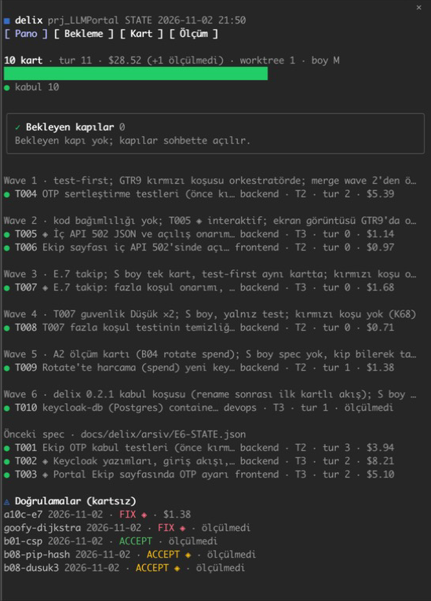
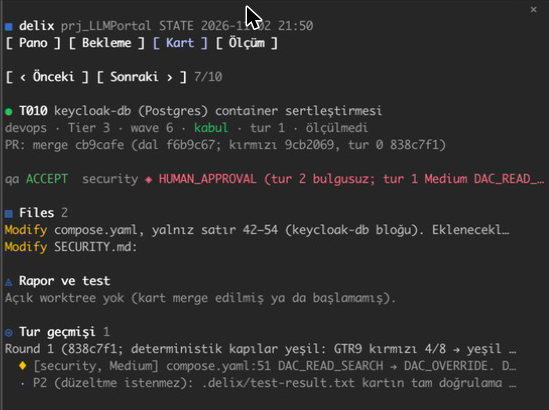
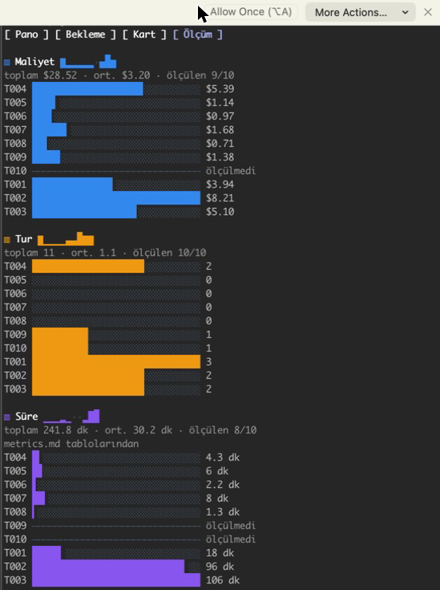
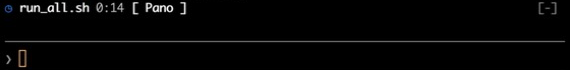

# delix-board — a live board for delix

A companion mod for [delix](../../README.md). It reads a delix project (`docs/delix/STATE.json`, the task cards,
`metrics.md`, the implementer worktrees' `.delix/` files) and shows it beside the chat: a pane with four views, a band
above the prompt while a long run is going, a status line entry and a toast when the run ends. It only reads; it writes
no project file and changes nothing in delix itself.



## Installation

```bash
claude plugin marketplace add tahircengiz/delixcrew
```

```bash
claude plugin install delix-board@delixcrew
```

delix and delix-board are independent: either can be installed without the other. For a one-off trial from a clone,
`claude --plugin-dir /path/to/delixcrew/plugins/delix-board`.

## Views

The pane opens by itself in a delix project; elsewhere `/delix-board` shows the empty state ("not a delix project").
Switch views with the tabs, the keys `1`–`4`, or the command:

| Command | View | Shows |
|---|---|---|
| `/delix-board` or `/delix-board pano` | Pano (board) | card count, rounds, cost, a status bar, pending gates (Tier 3 approval, merge, escalation), cards by wave, cards of the previous spec, verifications |
| `/delix-board bekleme` | Bekleme (wait) | tracked long runs: elapsed time, suites and PASS/FAIL counts, the last output lines, the expected duration from earlier runs |
| `/delix-board kart T010` | Kart (card) | one card: header, review verdicts, Files list, the worktree report and test result, review rounds with finding severities |
| `/delix-board olcum` | Ölçüm (metrics) | cost, rounds, duration and gates per card as bars, with totals; unmeasured values are marked, never guessed |




A Bash command matching `run_all.sh`, `upgrade_restore_drill`, `install_trial`, `release.sh`, `build.sh`,
`gh run watch`, `gh pr checks --watch` or `docker build`, and every `delixcrew:*` subagent, is tracked as a run. While it
runs, the band above the prompt shows it; the `extraPatterns` option adds patterns of your own.



## Surfaces

The terminal draws charts with Raster cells and text glyphs; the desktop app draws SVG icons and bars. Every view reads
on both. In a headless session (`claude -p`, the delix implementer and reviewer runs) the mod registers nothing and
draws nothing.

## Development

Checks: `claude plugin validate plugins/delix-board`, `claude plugin test plugins/delix-board` (view tests on a
synthetic project in `tests/fixtures.ts`). The design and its decisions (Turkish): [docs/spec/delix-board.md](../../docs/spec/delix-board.md).

## License

MIT, see [LICENSE](../../LICENSE).
